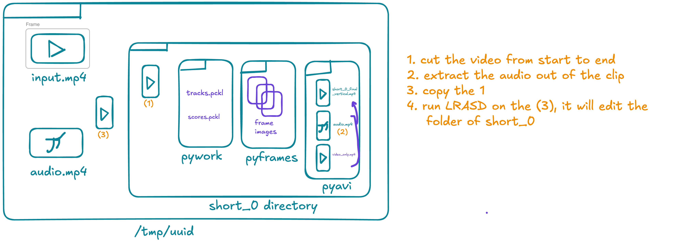
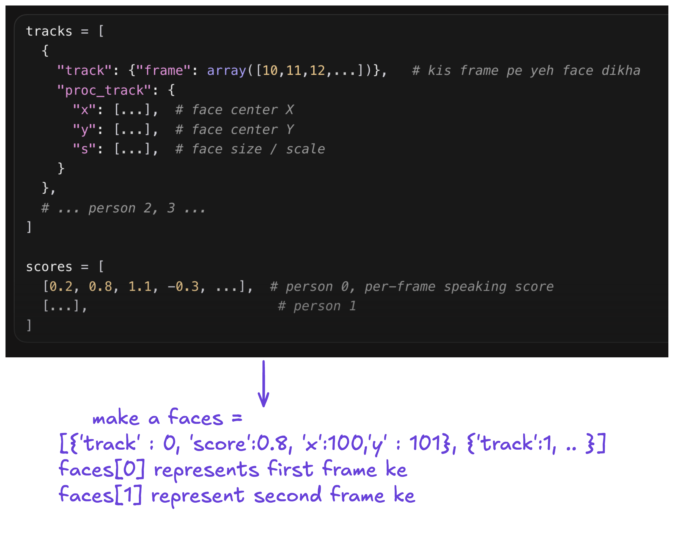
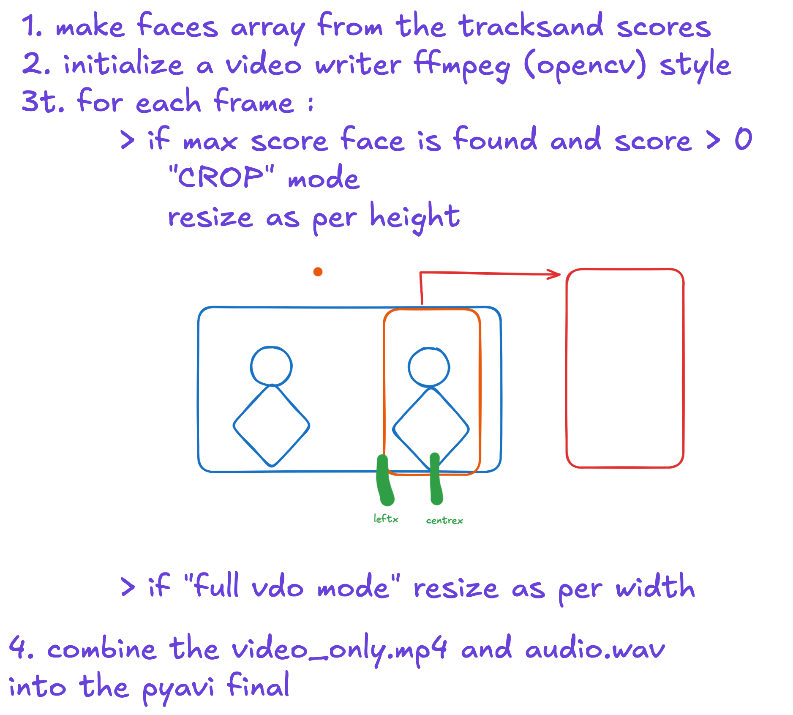

# AI Video Shorts Generator

A GPU-accelerated pipeline to automatically create vertical video shorts from podcasts or long videos.

---

## Description

**AI Video Shorts Generator** uses Python, Modal, WhisperX, Gemini API, and Active Speaker Detection to:
- Transcribe videos and accurately segment speech.
- Detect active speakers and keep the vertical frame focused on them.
- Automatically extract key moments (Q&A, stories, viral hooks) using Gemini API.
- Generate ready-to-upload vertical video shorts.

---

## Features

- **Transcription:** Uses WhisperX for accurate speech-to-text.
- **Moment Detection:** Finds questions, answers, and stories using Gemini API.
- **Active Speaker Detection:** Keeps the shot centered on whoever is speaking (LR-ASD model).
- **GPU-Accelerated:** Fast processing with Modal cloud GPUs.
- **Automated End-to-End:** Input a video, get vertical shorts as output.

---

## Pipeline

Each clip is processed in its own working folder under `/tmp/<uuid>/short_0`.



1. Cut the source video from the clip start to end.
2. Extract the audio from that clip.
3. Copy the cut segment into the working folder.
4. Run LR-ASD on that copy. It fills `short_0` with `pywork` (`tracks.pkl`, `scores.pkl`), `pyframes`, and `pyavi`.

LR-ASD writes one track per face and a speaking score per frame. Those are turned into a `faces` list indexed by frame.



The vertical render then walks every frame:



1. Build the `faces` array from tracks and scores.
2. Open an FFmpeg / OpenCV-style video writer.
3. For each frame, if the highest-scoring face has a score above 0, crop around that face (resize to height, then take a 1080-wide window around `centerx`). Otherwise use full-video mode and resize to width.
4. Combine `video_only.mp4` and `audio.wav` into the final file in `pyavi`.

---

## Demo Output 


You can watch sample output shorts here: 
- [Demo Short 1](https://www.youtube.com/shorts/QfNeYsNulfM)
- [Demo Short 2](https://www.youtube.com/shorts/BhJaQxAMmmQ)
- [Demo Short 3](https://www.youtube.com/shorts/-1SHfksjU1c)

The input video used:
- [Input Video](https://youtu.be/P6FjXQxs7bQ)

---
## Benchmarks 
(More than 64.2% retention rate of a 42 sec video thus proving its greater viral nature)

---


## Usage

1. Place your podcast or long video as `input.mp4` in the project directory.
2. Run:
   ```bash
   modal run process_video_on_modal.py --video-path ./input.mp4
   ```
3. Find the generated vertical shorts in `/output_shorts/` (e.g., `1.mp4`, `2.mp4`, ...).

---

## Requirements

- Modal account and CLI (`pip install modal`)
- Add your Gemini API key as a Modal secret named `gemini-secret`
- Python dependencies in `requirements.txt` (auto-installed by Modal container)


## Credits

- WhisperX for transcription
- Google Gemini API for moment extraction
- LR-ASD (Springer IJCV 2025) for active speaker detection
- Modal for GPU orchestration

---
